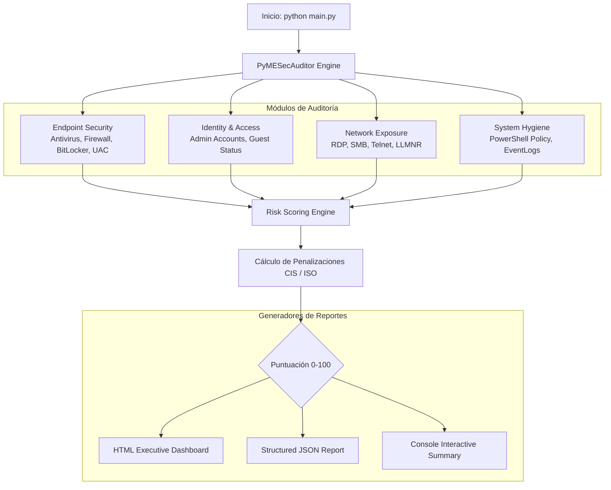

<div align="center">

# 🛡️ PyME-Sec-Audit
### *SME Cybersecurity Health Check & Compliance Baseline Audit Toolkit*

[](https://www.python.org/)
[](https://opensource.org/licenses/MIT)
[](https://www.cisecurity.org/controls)
[](https://github.com/RolandoPulgar/pyme-sec-audit)
[]()

**Herramienta automatizada de diagnóstico de postura de seguridad y cumplimiento de línea base diseñada específicamente para Pequeñas y Medianas Empresas (PyMEs).**

[Características](#-características-principales) • [Arquitectura](#-arquitectura-del-sistema) • [Instalación](#-instalación-rápida) • [Uso](#-ejemplos-de-uso) • [Reportes](#-reportes-generados) • [Autor](#-autor)

</div>

---

## 📌 ¿Por qué PyME-Sec-Audit?

El 60% de las PyMEs que sufren un incidente grave de ciberseguridad (ransomware, robo de credenciales, fraude BEC) quiebran en los siguientes 6 meses. Sin embargo, las soluciones de auditoría tradicionales son excesivamente complejas, caras o invasivas.

**PyME-Sec-Audit** nace como un toolkit **rápido, no invasivo y sin dependencias pesadas** que permite a consultores, analistas de seguridad y administradores de TI evaluar en menos de 60 segundos la salud de seguridad de un endpoint o servidor de trabajo, entregando un **Score de Riesgo (0-100)** y un **Informe Ejecutivo listo para presentar a la gerencia**.

---

## ✨ Características Principales

- 🔍 **Diagnóstico de Endpoint**:
  - Estado de antivirus y protección en tiempo real (Windows Defender / EDR).
  - Cobertura y activación del Firewall en perfiles Dominio, Privado y Público.
  - Cifrado de volumen completo con BitLocker (Protección contra robo físico).
  - Control de Cuentas de Usuario (UAC).
- 👤 **Identidad y Control de Accesos**:
  - Detección de cuentas de invitado (`Guest`/`Invitado`) activas.
  - Censo y detección de cuentas con privilegios excesivos en el grupo de Administradores locales (Principio de Menor Privilegio).
- 🌐 **Exposición de Red y Puertos Peligrosos**:
  - Identificación de servicios inseguros o vulnerables escuchando en red: RDP (3389), SMB (445), Telnet (23), FTP (21) y VNC (5900).
  - Auditoría del protocolo vulnerable **LLMNR** (Link-Local Multicast Name Resolution), vector #1 para ataques de envenenamiento NTLM y robo de hashes en red local.
- ⚙️ **Higiene de Sistema y Trazabilidad**:
  - Auditoría de políticas de ejecución de scripts PowerShell (`Restricted` vs `Unrestricted/Bypass`).
  - Estado del servicio de auditoría y registros de eventos (`EventLog`).
- 📊 **Generación de Reportes Dobles**:
  - **Informe Ejecutivo HTML**: Diseño moderno, autocontenido, responsive y con planes de acción priorizados.
  - **Informe Técnico JSON**: Estructurado para ingesta en herramientas SIEM, scripts de inventario o dashboards.

---

## 🏛️ Arquitectura del Sistema



---

## 🚀 Instalación Rápida

La herramienta utiliza exclusivamente la biblioteca estándar de Python 3.8+ para garantizar máxima portabilidad en entornos corporativos o servidores sin acceso a paquetes externos.

```bash
# Clonar repositorio
git clone https://github.com/RolandoPulgar/pyme-sec-audit.git
cd pyme-sec-audit

# (Opcional) Instalar dependencias adicionales de estética
pip install -r requirements.txt
```

---

## 💻 Ejemplos de Uso

### 1. Auditoría estándar con informe HTML ejecutivo
```bash
python main.py
# Genera por defecto: reporte_seguridad_pyme.html
```

### 2. Generar tanto HTML como JSON en una ruta específica
```bash
python main.py --format all --output auditoria_empresa.html
```

### 3. Modo silencioso para scripts de automatización / despliegue masivo
```bash
python main.py --format json --output resultados.json --quiet
```

---

## 📋 Mapeo de Cumplimiento y Normativas

Cada hallazgo incluye referencias directas a estándares internacionales reconocidos:

| Módulo | Control | Mapeo CIS Controls v8 | Mapeo ISO 27001 |
| :--- | :--- | :--- | :--- |
| **Endpoint** | Antivirus Real-time | CIS 10.1 (Anti-Malware) | ISO 27001 A.12.2.1 |
| **Endpoint** | Firewall de Red | CIS 4.4 (Firewall Protection) | ISO 27001 A.13.1.1 |
| **Endpoint** | Cifrado de Disco | CIS 3.11 (Encrypt Data at Rest)| ISO 27001 A.10.1.1 |
| **Identidad** | Cuentas Administradoras | CIS 5.4 (Restrict Admin Privileges) | ISO 27001 A.9.2.3 |
| **Red** | Protocolo LLMNR | CIS 4.8 (Disable Unnecessary Protocols) | MITRE ATT&CK T1557 |
| **Higiene** | PowerShell Policy | CIS 2.2 (Secure Configurations) | MITRE ATT&CK T1059 |

---

## 📄 Vista Previa de los Reportes

El informe HTML generado (`examples/sample_report.html`) incluye:
1. **Medidor Visual de Salud de Seguridad**: Calificación global de A a F.
2. **Resumen de Métricas**: Hallazgos categorizados por severidad (Crítico, Alto, Medio, Aprobado).
3. **Fichas de Hallazgos**: Explicación en lenguaje no técnico del impacto en el negocio.
4. **Comandos de Remediación Directa**: Bloques de PowerShell/Bash listos para copiar y ejecutar para mitigar el riesgo.

---

## 👤 Autor

**Rolando Pulgar**  
Consultoría en Ciberseguridad, Automatización e Infraestructura Segura para PyMEs  
- **GitHub**: [@RolandoPulgar](https://github.com/RolandoPulgar)  
- **Email**: `rpulgar@omenlabs.cl`  

---

## 📄 Licencia

Este proyecto está bajo la Licencia **MIT** - consulta el archivo [LICENSE](LICENSE) para más detalles.
